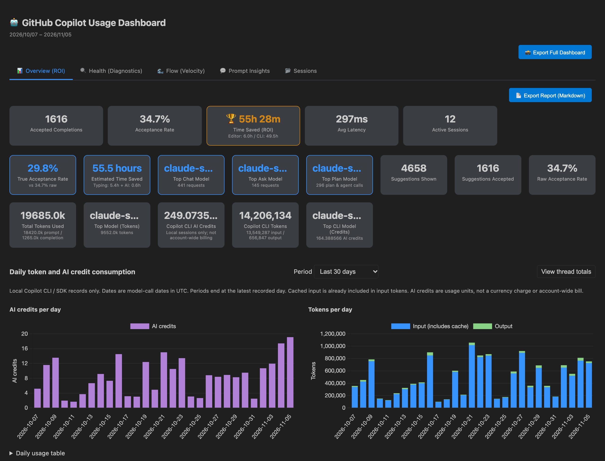
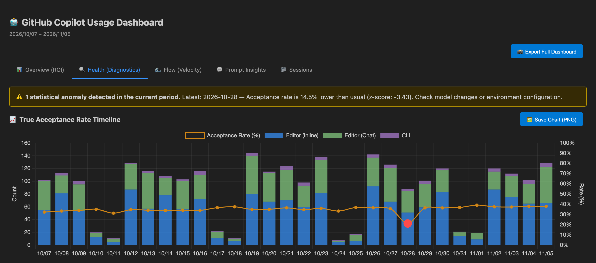
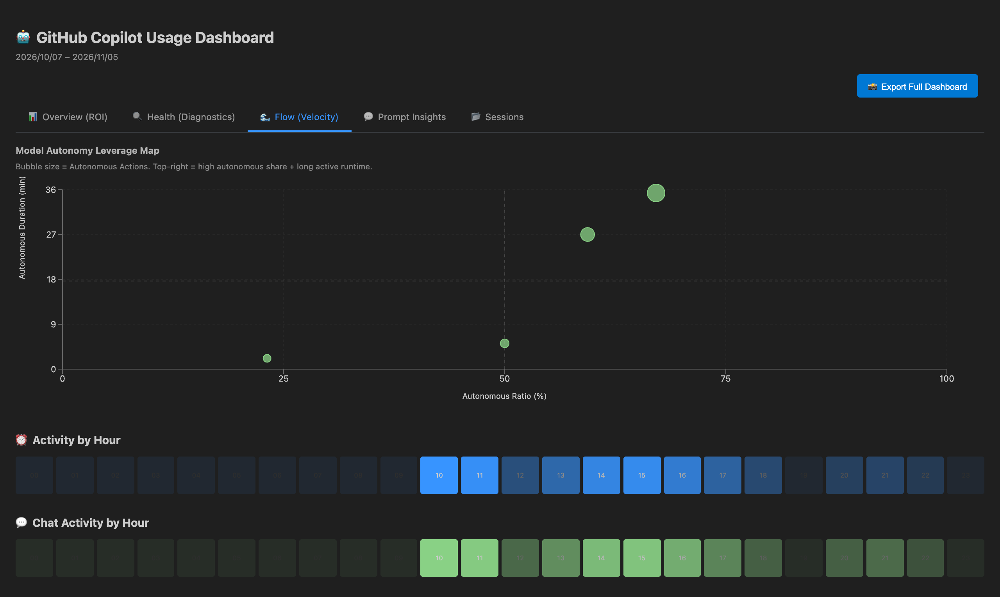
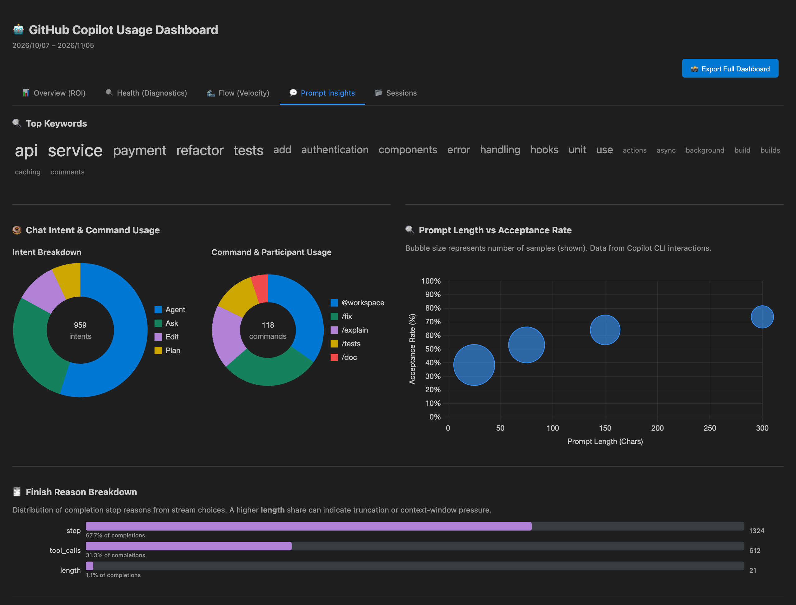
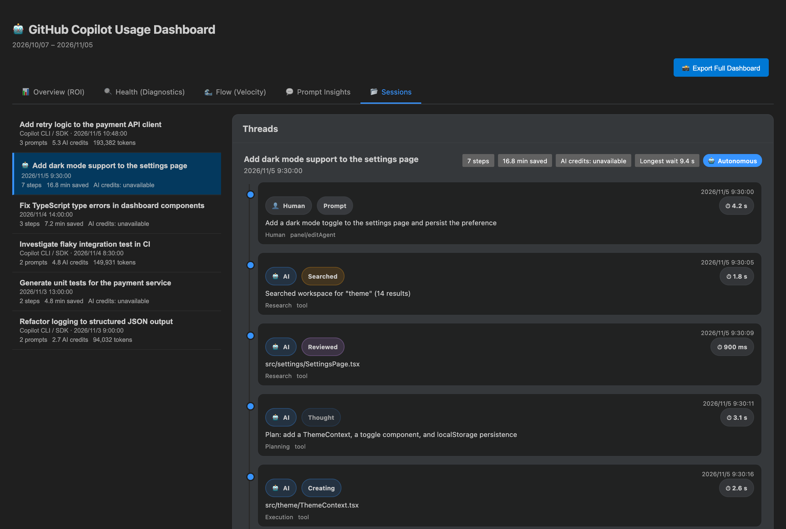

# Copilot Insight

> 🇬🇧 [English](#english) | 🇯🇵 [日本語](#japanese)



<sub>Screenshots use synthetic sample data. / スクリーンショットは架空のサンプルデータで描画しています。</sub>

---

<a name="english"></a>

## English

A 100% local, privacy-first VS Code extension that parses GitHub Copilot's local log files and visualizes your usage statistics in a blazingly fast, reactive dashboard. 

Stop guessing if AI is making you faster. Measure your ROI, track your prompt effectiveness, and prove that providing better context leads to better code.

### 🚀 Key Features

- **100% Local & Privacy-First** — No telemetry, no cloud servers. It parses local VS Code extension host logs and Copilot CLI session records on your machine.
- **ROI & True Acceptance Rate** — Tracks overall acceptance rate, declined suggestions, and estimated **minutes saved (ROI)** split into typing savings and agentic/autonomous savings.
- **Inline data limits** — Suggestion counts depend on local logs and can be incomplete. VS Code does not expose another extension's live Copilot completion events. True acceptance is unavailable without recorded acceptance observations and shown counts.
- **Exported rates** — CSV leaves acceptance rates empty when no suggestions were shown. JSON retains its numeric `summary.acceptanceRate` for compatibility and includes `summary.acceptanceRateAvailable` to indicate whether that value can be used.
- **Model Efficiency Breakdown** — Compares performance across different models, highlighting the best model for your specific codebase and separating Chat vs. Inline Completion effectiveness. Includes **token consumption** (prompt + completion tokens per model), Copilot CLI AI credits from local session records, and a **finish-reason distribution** chart showing how often completions end normally versus hitting the context-window limit.
- **Copilot CLI Usage** — Shows input/output and cached token totals, AI credits, and daily/model breakdowns from local CLI session records. VS Code Chat credits are not included in this CLI total.
- **Daily Consumption & Thread Costs** — Overview charts show AI credits and input/output tokens by model-call date (UTC), with 7-day, 30-day, and full-history views. Sessions includes CLI/SDK conversation totals and per-prompt consumption alongside editor threads.
- **Activity & Flow** — Activity heatmaps by hour of the day, weekly trend comparisons, and KPM (Keystrokes Per Minute) vs. completions scatter plots.
- **MCP Server Built-in** — Exposes `get_usage_summary`, `get_model_efficiency`, and `get_anomaly_report` tools via the Model Context Protocol, allowing external AI agents (like Claude Desktop) to query your stats locally.

### 🛠️ Under the Hood (Architecture)

Copilot Insight is built for extreme performance without bloating your editor:
- **Backend (Rust + NAPI-RS)**: The log parsing engine is entirely written in Rust. It performs zero-copy, OS-level file I/O to parse massive log files instantly, bypassing Node.js memory limits.
- **Frontend (Lit)**: The dashboard UI is built with the **Lit** framework, using lightweight, reactive Web Components that render smoothly without the overhead of heavy SPA frameworks.
- **Database (DuckDB)**: Utilizes local DuckDB (Wasm) for executing fast, analytical queries on the parsed metrics.

### 🗂️ Dashboard Tabs

- 📊 **Overview (ROI)**: Summary cards, auto-generated Insights, and Weekly Trends.
- 🔍 **Health (Diagnostics)**: Activity and acceptance-rate timelines, daily usage, and **Agent Intelligence Overview** (Planning & Execution stats, autonomous action counts). CLI / SDK prompt counts are shown separately from accepted inline suggestions.
- 🌊 **Flow (Velocity)**: KPM scatter plots, activity heatmaps, and **Context Effectiveness** breakdown by source (Active File, Workspace, Symbol, Embeddings).
- 💬 **Prompt Insights**: Tag Cloud of frequent terms, Intent Command donut, prompt length versus observed response rate, saved chat sessions by request count, and **Context Leverage** chart (Context size vs. Acceptance rate). A recorded response is not a measure of acceptance, quality, or task completion.
- 📂 **Sessions**: Session Intelligence Explorer. Drill down into chat threads, user prompts, file edits, and memory refreshes.

<details>
<summary>📸 Screenshots of each tab (sample data)</summary>

**🔍 Health (Diagnostics)**



**🌊 Flow (Velocity)**



**💬 Prompt Insights**



**📂 Sessions**



</details>

### How to Use

1. Open the Command Palette (`Ctrl+Shift+P` / `Cmd+Shift+P`)
2. Run **Copilot Insight: Show Usage**
3. The usage dashboard panel opens automatically.

Alternatively, click the **Copilot Insight** icon in the Activity Bar on the left side of VS Code.

#### Token and AI credit consumption

- Open **Overview → Daily token and AI credit consumption** for the daily graphs and the expandable data table. Periods end on the latest recorded day; only locally recorded model calls are shown.
- Select **View thread totals** or open **Sessions**, then select a **Copilot CLI / SDK** thread. Its header shows the conversation total; each prompt shows the calls recorded before the next prompt. Previews stay local and are limited to 160 characters.
- Cumulative checkpoints can include adjustments (for example Fusion accounting) without a call timestamp or prompt association. These remain in the thread total; differences from the daily graphs are shown separately, never assigned to the session start date. New calls after a checkpoint are included.
- Cached input is already part of input tokens. Missing credit data is **Unavailable**, not zero. Credits are Copilot usage units, not a currency bill; other devices and unrecorded VS Code Chat usage are not covered. Use **Copilot Insight: Refresh** to read newly appended records. Existing snapshots without thread details require a refresh.
- The same view shows observed model-call timing across the recorded history and separates human permission responses from host policy decisions. Sessions show recorded context compactions and subagent relationships. Timing comparisons do not control for task differences; unavailable fields are not inferred. Agent-origin messages are shown separately from human prompts. Refresh older snapshots to populate these details.

### Configuration

| Setting | Default | Description |
|---|---|---|
| `copilot-insight.maxSessionDirs` | `10` | Number of recent VS Code session directories to scan for Copilot logs (1–20) |
| `copilot-insight.defaultDisplayDays` | `14` | Default number of days shown in the Daily Usage chart (7, 14, or 30) |
| `copilot-insight.enableAdvancedAnalysis` | `true` | Enable the advanced analysis worker for deep metrics |
| `copilot-insight.cliLogPath` | `""` | Path to the GitHub Copilot CLI session-state directory |
| `copilot-insight.cliRoiMinutesPerInteraction` | `30` | Estimated minutes saved per GitHub Copilot CLI interaction |
| `copilot-insight.cliDefaultModel` | `"Copilot CLI"` | Fallback model name label for CLI interactions |
| `copilot-insight.enableTimingLogs` | `false` | Emit detailed `[TIMING]` entries to the Output panel during log parsing (intended for troubleshooting slow parses) |

### Installing from VSIX (local build)

1. Build the extension package:
   `npm run package`
2. Install the generated VSIX file in VS Code via Command Palette (**Extensions: Install from VSIX...**) or CLI:
   `code --install-extension copilot-insight-<version>.vsix`

### Building the Native Rust Parser

The extension ships with a fast JS fallback, but compiling the Rust native addon unlocks maximum performance.

```bash
# 1. Build the native addon (outputs a .node file via NAPI-RS)
npm run build:native

# 2. Run the Rust unit tests
cd native-parser && cargo test
```

Restart the VS Code extension host (**Developer: Reload Window**) to apply.

### Integration tests

Run `npm test` for the VS Code integration suite. To build and install a VSIX in an isolated profile and test the dashboard, set `VSCODE_EXECUTABLE_PATH` to the VS Code executable and run `npm run test:vsix`. This smoke test requires Rust and a graphical display; on Linux it can run under `xvfb-run -a`.

---

<a name="japanese"></a>

## 日本語

インライン補完の件数はローカルログに記録された範囲に限られます。VS Code は他の拡張機能の Copilot 補完イベントをリアルタイムに公開していません。採用イベントまたは表示件数が記録されていない場合、True Acceptance Rate は算出できません。

表示件数がゼロの場合、CSV の採用率は空欄です。JSON は互換性のため数値を保持し、`summary.acceptanceRateAvailable` で率を算出できるかを示します。

GitHub Copilot のローカルログファイルを解析し、使用統計を高速かつリアクティブなダッシュボードで可視化する、100%ローカル・プライバシーファーストな VS Code 拡張機能です。

AIが本当に開発を高速化しているのかを推測するのはやめましょう。ROIを測定し、プロンプトの有効性を追跡し、「適切なコンテキスト（周辺情報）を与えるほど優れたコードが生成される」という事実をデータで証明します。

### 🚀 主な機能

  - **100% ローカル & プライバシーファースト** — 外部サーバーへのテレメトリ送信は一切ありません。マシン上の VS Code ログと Copilot CLI のセッション記録を解析します。
  - **ROI と真の受け入れ率** — 全体の受け入れ率、拒否された提案数、および推定**節約時間 (ROI)** を「タイピングによる節約」と「自律エージェントによる節約」に分けて追跡します。
  - **モデル効率の内訳** — 言語モデル間のパフォーマンスを比較し、特定のコードベースに最適なモデルを特定します（ChatとInline補完の有効性も分離して分析）。モデルごとの**トークン消費量**（プロンプトトークン＋補完トークン）に加え、Copilot CLI のローカルセッション記録から取得したAIクレジットを表示します。
  - **Copilot CLI 使用量** — ローカルセッション記録から入力・出力・キャッシュトークン、AIクレジット、日別・モデル別の内訳を表示します。このCLI集計にはVS Code Chatのクレジットは含まれません。
  - **日別消費グラフとスレッド別費用** — Overviewで呼び出し日時（UTC）に基づくAIクレジット・入力／出力トークンを7日・30日・全履歴で表示。SessionsではCLI/SDKスレッド全体の累計と、プロンプトごとの消費量を確認できます。
  - **アクティビティとフロー** — 時間帯別のアクティビティヒートマップ、週次トレンド比較、KPM（1分あたりのキーストローク）と補完受け入れ数の散布図を表示します。
  - **MCP サーバー内蔵** — Model Context Protocol サーバーを内蔵しており、Claude Desktop などの外部AIエージェントが、ローカルであなたの使用統計（`get_usage_summary` 等）を直接照会できます。

### 🛠️ アーキテクチャ (Under the Hood)

エディタの動作を重くすることなく、極限のパフォーマンスを引き出すために設計されています：

  - **バックエンド (Rust + NAPI-RS)**: ログ解析エンジンはすべてRustで書かれています。Node.jsのメモリ制限を回避し、OSレベルでのゼロコピー・ファイルI/Oにより、巨大なログファイルを瞬時に解析します。
  - **フロントエンド (Lit)**: ダッシュボードUIは **Lit** フレームワークで構築されています。重いSPAフレームワークのオーバーヘッドなしに、軽量でリアクティブな Web Components として高速にレンダリングされます。
  - **データベース (DuckDB)**: 解析されたメトリクスに対する高速な分析クエリの実行に、ローカルの DuckDB (Wasm) を利用しています。

### 🗂️ ダッシュボードタブ構成

  - 📊 **Overview (ROI)**: サマリーカード、自動生成Insights、週次トレンド。
  - 🔍 **Health (Diagnostics)**: 真の受け入れ率タイムライン、日次使用状況、**Agent Intelligence Overview** (自律アクション数・Planning & Execution 統計)。
  - 🌊 **Flow (Velocity)**: KPM散布図、ヒートマップ、**コンテキスト効果** (Active File / Workspace / Embeddings 等のソース別貢献度)。
  - 💬 **Prompt Insights**: 頻出用語タグクラウド、プロンプト長散布図、**コンテキストレバレッジ**チャート (参照ファイル数バケット別の受け入れ率)。
  - 📂 **Sessions**: Session Intelligence Explorer。チャットスレッド、ユーザープロンプト、ファイル編集のタイムラインをドリルダウン解析。

<details>
<summary>📸 各タブのスクリーンショット (サンプルデータ)</summary>

**🔍 Health (Diagnostics)**


**🌊 Flow (Velocity)**


**💬 Prompt Insights**


**📂 Sessions**


</details>

### 使い方

1.  コマンドパレットを開きます (`Ctrl+Shift+P` / `Cmd+Shift+P`)
2.  **Copilot Insight: Show Usage** を実行します
3.  使用状況ダッシュボードのパネルが自動的に開きます。

（または、アクティビティバーの **Copilot Insight** アイコンをクリック）

#### トークン・AIクレジットの確認

- **Overview → Daily token and AI credit consumption**で日別グラフと数値表を確認できます。期間の終点は最新の記録日で、日付はUTCです。
- **View thread totals**または**Sessions**から **Copilot CLI / SDK** のスレッドを選択すると、スレッド累計と各プロンプトから次のプロンプトまでの呼び出し消費量を表示します。プロンプトのプレビューは160文字までで、ローカルにのみ保持します。
- Fusionなどの累計補正や日時不明の利用量は、開始日に押し込まずスレッド累計に含め、日別グラフとの差分を別表示します。キャッシュ分を入力トークンに重ねて加算することはありません。
- 費用を取得できない場合は0ではなく **Unavailable（未取得）** と表示します。AIクレジットは利用単位で、請求確定額ではありません。他端末や未記録のVS Code Chat利用は対象外です。最新ログの反映・古い保存データの更新には **Copilot Insight: Refresh** を実行してください。

### 設定

| 設定 | デフォルト | 説明 |
|---|---|---|
| `copilot-insight.maxSessionDirs` | `10` | Copilotログをスキャンする直近の VS Code セッションディレクトリ数 (1〜20) |
| `copilot-insight.defaultDisplayDays` | `14` | 日次使用チャートのデフォルト表示日数 (7・14・30) |
| `copilot-insight.enableAdvancedAnalysis` | `true` | 高度な分析ワーカーを有効にする |
| `copilot-insight.cliLogPath` | `""` | GitHub Copilot CLI セッション状態ディレクトリのパス |
| `copilot-insight.cliRoiMinutesPerInteraction` | `30` | CLI インタラクション 1 回あたりの推定節約時間 (分) |
| `copilot-insight.cliDefaultModel` | `"Copilot CLI"` | CLI ログからモデル名を検出できない場合のフォールバック |
| `copilot-insight.enableTimingLogs` | `false` | ログ解析中に詳細な `[TIMING]` エントリを Output パネルへ出力する（低速な解析のトラブルシューティング用） |

### VSIX からのインストール (ローカルビルド)

1.  パッケージをビルドします:
    `npm run package`
2.  コマンドパレット (**Extensions: Install from VSIX...**) または CLI からインストール:
    `code --install-extension copilot-insight-<version>.vsix`

### ネイティブ Rust パーサーのビルド

JSのフォールバックパーサーでも動作しますが、Rustネイティブアドオンをコンパイルすることで最大のパフォーマンスが解放されます。

```bash
# 1. ネイティブアドオンをビルド (NAPI-RS経由で .node ファイルを出力)
npm run build:native

# 2. Rust ユニットテストを実行
cd native-parser && cargo test
```

適用するには VS Code ウィンドウを再読み込み (**Developer: Reload Window**) してください。

### 結合テスト

`npm test` で VS Code の結合テストを実行します。VSIX をビルドして隔離プロファイルにインストールし、ダッシュボードを検証するには、`VSCODE_EXECUTABLE_PATH` に VS Code の実行ファイルを指定して `npm run test:vsix` を実行します。Rust と画面表示環境が必要です。Linux では `xvfb-run -a` を利用できます。
